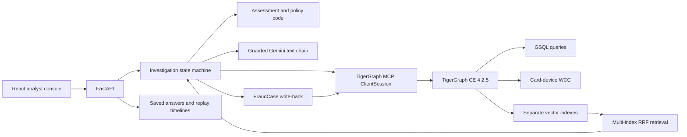

# FRAUDLOOP

FRAUDLOOP investigates the 20 HHGOA fraud alerts using TigerGraph evidence, historical cases, policy rules, and guarded model narration. Assessment and policy code decide probabilities, verdicts, recommendations, approval routes, and stopping conditions. Gemini writes the summary, SAR narrative, and explanation of changed recommendations from the retrieved evidence.

All bank actions are recommendations. Evidence responses are either disclosed deterministic simulations or human entries attributed to the answering demo role and timestamp. Generated case memory is an earlier agent conclusion, not a confirmed historical bank outcome. Evidence is bounded by each case's `opened_at`; original Kaggle fraud labels are never used.

The preserved graded answers contain **9 fraud, 8 legitimate and 3 uncertain judgments, with 2 SAR recommendations**. All 20 passed schema, dataset-ID, exposure, chronology, route and policy validation at the overnight baseline. These are policy-engine judgments, not measured accuracy against the hidden answer key. See [the complete policy audit](docs/policy-audit.md), [the blog draft](docs/blog.md), [the four-minute video script](docs/video-script.md), and [the morning delivery report](docs/MORNING_REPORT.md).

## Start the analyst console

Requirements: Python 3.12, Node.js 22 (or another Vite-supported Node version), npm, Bash, and `setsid` from util-linux. Use the existing prepared dataset, `data/transaction_store.pkl`, `data/graph/`, and saved `cases/` files. Do not re-provision the graph or rebuild embeddings merely to open the demo.

```bash
# Existing checkout: preserve .env and all prepared data.
python3.12 -m venv .venv
.venv/bin/python -m pip install -e '.[dev]'
npm --prefix frontend ci
# Fresh checkout only: create .env if it does not exist, then configure locally.
test -f .env || cp .env.example .env
make demo
```

Open **http://localhost:5173**. The backend is **http://127.0.0.1:8000**, with interactive API documentation at **http://127.0.0.1:8000/docs**. The Vite server proxies `/api` to port 8000. `make demo` starts one backend worker and the frontend, refuses occupied ports, and stops its own process groups when either server exits or you press Ctrl+C. It does not terminate unrelated processes.

Use **Replay** on HHG-014 for graph expansion and SAR routing, and on HHG-002 for a changed recommendation after simulated confirmation. Saved replay events require no graph or model calls. Some events reconstructed from older traces are labeled as reconstructed and have no measured per-tool duration; fresh live runs capture actual tool events. For an entirely local demo, including graph-neighborhood reads:

```bash
FRAUDLOOP_LOCAL_ONLY=1 FRAUDLOOP_ENABLE_LLM=0 make demo
```

The **Run live** control starts the real state machine. It uses official MCP graph operations when available and truthful local fallback otherwise. A successful API run atomically saves `cases_live/<case_id>.json` as a snapshot envelope containing `answer`, `trace`, `timeline`, and `run_id`; the stream emits `done` only after that snapshot is saved. The API unwraps its answer and serves the matching trace/replay. Failed attempts are stored separately under `data/runtime_failed_timelines/<case_id>-<run_id>.json`, preserving the last successful snapshot and committed replay. New live timelines are saved in `data/timelines_live/`. Legacy runtime snapshots, traces and timelines remain readable. Graded `cases/` files and committed timelines are never overwritten by API runs. A successful runtime answer takes precedence in the console, with its source labeled. New trigger creation first queues a retrospective case; opening the returned POST stream starts its investigation.

Live narration uses the configured Gemini fallback chain. Set `FRAUDLOOP_ENABLE_LLM=0` before starting the backend for template-only narration; attempts are capped at 60 in the persistent `data/api_llm_budget.json`. Do not clear that file during a quota-limited run. Replay never spends that budget. Model-backed retrieval in a live run may also need the relevant query embedding provider and quota; replay is the dependable recording path.

| Target | Purpose |
|---|---|
| `make backend` | Start one FastAPI/uvicorn worker on 127.0.0.1:8000 |
| `make frontend` | Start Vite on 127.0.0.1:5173 |
| `make demo` | Start both and clean up both on exit |
| `make validate` | Validate the 20 graded answer files without changing them |
| `make test` | Run Python agent/backend tests |
| `make smoke` | Exercise a running API; creates one queued runtime trigger, uses replay, checks expected viewer 403 |
| `make cases CASE_ARGS=--no-llm` | Deliberately regenerate graded answers and FraudCase memory after the GSE guard passes |

`make cases` is a writer, not a demo startup step. Its wrapper checks `gadmin status gse`, tries one restart and a 30-second wait only when GSE is down, and skips generation if service health is still down or unknown. It never provisions schema or starts embeddings. Preserve the validated submission before any deliberate regeneration. The overnight build does not regenerate already-valid answers for UI polish.

## Architecture and required components



| Required component | Implementation and evidence |
|---|---|
| TigerGraph | `FraudGraph` links Customer, Card, Txn, DeviceProfile, EmailDomain, BillingRegion, ClosedCase, DocChunk and FraudCase vertices. Prepared data contains 205,992 relevant transactions and 5,565 historical cases. |
| GSQL and algorithms | Installed queries retrieve card windows/baselines, device and region neighborhoods, prior cases, documents, vectors and generated memory. Historical live WCC verification covered 13,831 Card–Device vertices and 4,954 components; connectivity is not itself proof of fraud. |
| MCP | Runtime graph traffic uses the official TigerGraph MCP server through an MCP `ClientSession`. The backend serializes MCP/live work behind an asyncio lock and runs only one worker. Docker/GSQL is used for administration, not a hidden runtime query path. |
| GraphRAG | Graph paths and analyst narratives combine with separate 768-dimensional model-owned vector indexes through RRF (`k=60`). Partial indexes remain useful; provenance and temporal eligibility are preserved. |
| UI | React 18, Vite, TypeScript, Tailwind, TanStack Query, React Router and Cytoscape provide a queue, case detail/timeline, graph, precedents, approvals and memory pages. |
| Agentic loop | `TRIGGER → GATHER → ASSESS → INITIAL_NBA → REQUEST_EVIDENCE → REASSESS → FINAL_NBA → SAR → WRITE_BACK → ANSWER`, with evidence requests and reassessment omitted when a defensible stopping condition already holds. |

The agent chooses evidence requests around unresolved authorization, exposure and precedent evidence; records initial and final recommendations; enforces policy permissions; and stores completed investigations as retrievable case memory. Risk scores do not anchor its decision. Correlated signals are capped within evidence families, and retrieved historical outcomes are corrected for the fraud-heavy sample.

## API and permissions

| Method and endpoint | Response or effect |
|---|---|
| `GET /api/health` | GSE/GPE/RESTPP status, MCP reachability, cached Gemini/quota state and checkpoint coverage; no live text-model probe |
| `GET /api/cases` | Case queue with verdict, probability, status, SAR and pending approval count |
| `GET /api/cases/{id}` | Answer, trigger, recorded timeline, family contributions and answer source |
| `GET /api/cases/{id}/timeline` | Stored or currently running event list |
| `POST /api/cases/{id}/investigate?mode=replay` | SSE replay of recorded events; no model/graph calls |
| `POST /api/cases/{id}/investigate?mode=live` | Background investigation streamed through SSE |
| `POST /api/investigations` | Queue a new `risk_signal`, `customer_report` or `analyst_request`; return its case ID and POST stream URL |
| `GET /api/cases/{id}/graph` | Bounded graph neighborhood, at most 150 nodes, with labeled local fallback when needed |
| `GET /api/cases/{id}/precedents` | Earlier closed cases, outcome, available similarity and retrieval provenance |
| `GET /api/approvals` | Pending L1/L2 recommendations and local audit trail |
| `POST /api/approvals/{id}` | Record `{ "decision": "approve" or "reject", "note": "..." }`; enforce the `X-Role` permission |
| `GET /api/memory/stats` | Historical case count, per-index checkpoint coverage, patterns and recurring profiles/regions |

SSE events include `step_started`, `tool_call`, `evidence_added`, `assessment`, `nba_initial`, `evidence_requested`, `evidence_received`, `nba_final`, `sar_drafted`, `case_written`, `done` and `error`. This is a POST stream, so clients use streaming `fetch`, not a GET-only `EventSource`. For example:

```bash
curl --no-buffer -X POST \
  'http://127.0.0.1:8000/api/cases/HHG-002/investigate?mode=replay'
```

The top-bar role switcher sends `X-Role: viewer`, `analyst_l1`, or `supervisor_l2`. Viewer has no approval rights; L1 decides only L1 actions; L2 decides either level. Wrong roles return 403. Decisions persist in `data/approvals.json`, then an audit entry is added to the FraudCase if the GSE write guard passes. A failed graph audit is reported truthfully while retaining the local decision. **The role header is a local demonstration mechanism, not authenticated identity; keep this service on your trusted workstation.**

Approval records do not execute bank actions. Human evidence entries record their source, answering demo role and timestamp; simulated replies remain explicitly labeled. No real customer was contacted, card blocked, or SAR sent. Saved answers predate the multi-index retrieval refactor and used template narration; missing historical similarity/provenance is shown as missing rather than fabricated. Generated memory is not confirmed bank truth, and shared coarse profiles or billing-region codes alone do not establish a fraud ring.

## Human evidence in live investigations

Choose **Human** under **Evidence responses** in New investigation, or on a case
before choosing **Run live**. When policy needs more evidence, the agent persists
its assessment in `data/pending_evidence.json`, publishes `evidence_requested`,
and releases its graph session while it waits. Early stopping still applies: a
case with enough evidence may finish without requesting another response.

The case page shows the reason, supporting precedents and initial actions. Select
**analyst_l1** or **supervisor_l2**, choose a response, add a note, and submit. The
same SSE timeline continues through reassessment, final actions and the SAR
decision. **What changed** explains the effect. Human notes do not themselves
establish authorization; explicit customer and step-up response types drive the
existing policy reassessment.

`POST /api/cases/{id}/evidence` accepts `request_id`, `response_type` and `note`.
Response types are `customer_confirms`, `customer_denies`, `stepup_passed`,
`stepup_failed`, and `analyst_note`. The role header is required. A stale request
or conflicting second response is rejected. Disconnecting the browser does not
cancel the request; reconnecting or restarting the server resumes the persisted
assessment. Human entries retain who answered and when in `evidence_requests`.
This records an analyst's entry, not an authenticated bank-customer interaction.

Live answers and replays are isolated in `cases_live/` and
`data/timelines_live/`; the twenty graded answers and `data/timelines/` remain
untouched. New live summary vectors use the existing BGE `emb_bge` attribute.

## Docker Compose

Compose starts **only the backend and frontend**. The existing TigerGraph container remains `tg`; this project does not create, replace, migrate, or reconfigure it. The default compose configuration uses local/replay mode, exposes only loopback ports, and does not mount the Docker socket.

```bash
# Check source paths exist before starting: these are preserved operator data.
test -f .env
test -f data/transaction_store.pkl
test -f HHGOA_IEEE/case_pack.csv
test -d data/timelines
export FRAUDLOOP_UID="$(id -u)"
export FRAUDLOOP_GID="$(id -g)"
docker compose config --quiet
docker compose build backend
docker compose build frontend
docker compose up
# Stop these services after use:
docker compose down
```

Build the images sequentially to limit peak RAM. No container build was needed to validate the Python or frontend source; see the morning report for whether actual images were built in this environment. URLs remain http://localhost:5173 and http://127.0.0.1:8000. Nginx serves the built React app, preserves client-side routes, and proxies `/api` with buffering disabled for SSE.

`.dockerignore` permits application sources only: `.env`, datasets, checkpoints, caches, pickles, graded answers and `node_modules` are excluded from image contexts. `.env` is supplied to the backend at runtime, never copied into an image. The supplied `HHGOA_IEEE/` directory, prepared graph inputs/store, graded cases and committed timelines are mounted read-only. Other `data/` paths remain writable for runtime answers, approvals and quota state. UID/GID settings let the default container write your existing runtime directory without changing its ownership.

For live graph integration, the backend's health and write guard require Docker CLI access to the existing `tg` container. The image includes the CLI, but the daemon socket is **opt-in**:

```bash
# Native Docker commonly uses this socket; Docker Desktop may use another path.
export FRAUDLOOP_DOCKER_SOCKET=/var/run/docker.sock
docker compose -f docker-compose.yml -f docker-compose.graph.yml config --quiet
docker compose -f docker-compose.yml -f docker-compose.graph.yml up
```

The graph override runs the backend as root and mounts the selected daemon socket; this grants it Docker control, including the one permitted GSE restart. Use it only on a trusted local workstation. Find the active socket without exposing credentials with `docker context inspect --format '{{(index .Endpoints "docker").Host}}'`, remove the `unix://` prefix, and set `FRAUDLOOP_DOCKER_SOCKET` accordingly. A Docker Desktop socket must target the daemon that owns `tg`.

Inside Compose, `TG_HOST` defaults to `http://host.docker.internal`, with Linux `host-gateway` mapping, because `localhost` inside the backend is not the existing TigerGraph container. `TG_RESTPP_PORT=9000` and `TG_GS_PORT=14240` remain separate connection settings from `.env`. Set `FRAUDLOOP_COMPOSE_TG_HOST` if your published TigerGraph host differs. Without a working socket/GSE check, graph writes are skipped and reads use a labeled local fallback even if REST is reachable. On Fedora with SELinux-enforced bind mounts, use an appropriately labeled local project directory; avoid recursively relabeling the operator's dataset or Docker socket merely to run a demo.

## Agent and model setup

The following sections retain the existing model/index maintenance workflow. Migration and embedding commands are **not demo prerequisites** and must not be run during the overnight build, whose guardrails prohibit schema changes and embedding jobs. They are documented for a later, deliberate maintenance session.

Use Python 3.12 and the existing TigerGraph Community 4.2.5 `FraudGraph` instance. Runtime graph operations use the official TigerGraph MCP server through `ClientSession`; provisioning uses Docker/GSQL.

```bash
python3.12 -m venv .venv
.venv/bin/python -m pip install -e '.[dev,gemma]'
# On a new checkout, create .env from .env.example and fill in credentials.
# Preserve an existing .env.
```

The `gemma` extra installs sentence-transformers and a compatible transformers version. EmbeddingGemma weights may require accepting Google's model terms on Hugging Face and setting `HF_TOKEN`. If unavailable, ingestion continues using **BGE's separate index**. BGE uses fastembed on CPU; neither local model spends Gemini quota.

Set `GEMINI_API_KEY` for all generation and `GEMINI_EMBEDDING` for embedding builds and query embeddings. The process keeps two SDK clients, including when the embedding key falls back to the generation key with a warning. **Free-tier quota is per Google Cloud project: the keys must belong to different projects to have separate limits.** Keys are never logged or saved in the registry.

## Discovery and fallback

```bash
.venv/bin/python -m agent.model_registry --refresh-models
```

Discovery lists models with each key, classifies `generateContent` and `embedContent`, and excludes live, TTS, image, and audio models. Results are cached for 24 hours in `data/model_registry.json`. `--refresh-models` is also available on `run_cases`, `embed_docs`, `check_models`, and `migrate_embeddings`.

An empty `GEMINI_MODEL_CHAIN` selects all discovered text candidates: newest Flash, older Flash, Flash Lite, then other text models. A nonempty chain overrides that order and selection; existing `.env` overrides are preserved. `models.list()` reports capabilities, **not free-tier entitlement or a guarantee of remaining quota**. Use projects without billing enabled to enforce free-only execution; a billed project can charge for listed models. The system does not enable billing or purchase quota. Access failures fall through to the next model.

A 429 with a `QuotaFailure.quotaId` containing `PerDay` disables that model until the next midnight in `America/Los_Angeles`, including daylight-saving changes. `PerMinute` and unclassified 429s use `retryDelay`, defaulting to 30 seconds. State persists by credential scope and model in `data/quota_state.json`. Generation moves immediately to the next usable model; embedding builds can retry after short minute cooldowns. A 503 gets two retries after 2 and 5 seconds. Exhausting the chain returns guarded template prose. Answer metadata records `llm_model_used` and `llm_attempts`, and traces retain every attempt and token usage.

## Separate embedding indexes

| Index | Model | TigerGraph attribute |
| --- | --- | --- |
| gem001 | gemini-embedding-001 | `embedding` (preserved legacy mapping) |
| gem2 | gemini-embedding-2 | `emb_gem2` |
| gemma | google/embeddinggemma-300m | `emb_gemma` |
| bge | BAAI/bge-base-en-v1.5 | `emb_bge` |

Each attribute is a 768-dimensional cosine HNSW index on `ClosedCase`, `DocChunk`, and `FraudCase`. A discovered preview or additional embedding model gets its own stable hash-suffixed attribute; previews never share stable-model vectors. `--provider gem2` includes discovered stable and preview Embedding 2 models. All vectors are L2-normalized, with model/attribute checks before writes and queries.

The existing `embedding` attribute and `data/embedded_ids.txt` are retained unchanged. Gemini 001 imports those checkpoint IDs into `data/checkpoints/gemini-embedding-001.txt`. Other models have their own files under `data/checkpoints/`; local graph mode uses a separate subdirectory. Checkpoints advance only after successful persistence. Cached generated vectors survive failed uploads. The old destructive `--rebuild` workflow is removed.

EmbeddingGemma uses `task: search result | query: ` for queries and `title: none | text: ` for documents. [Google's prompt documentation](https://ai.google.dev/gemma/docs/embeddinggemma/inference-embeddinggemma-with-sentence-transformers) describes the retrieval prompts. `EMBED_DEVICE=auto` (default) selects CUDA when `torch.cuda.is_available()`; `cpu` forces CPU and `cuda` requests CUDA with CPU fallback when unavailable. CUDA uses fp16 weights and batches of 64; CPU uses fp32 and batches of 16. A CUDA out-of-memory error retries once at half the current batch size, then falls back to CPU if that retry also runs out of memory. The reduced batch size or CPU fallback persists for later calls. Gemma ingestion feeds groups of up to 64 texts independently of `--batch-size`; the embedder splits them for its current device. Embedding 2 uses one document per request to avoid combining multiple documents into a single multimodal embedding.

```bash
# Add attributes and install per-index queries; preserve all business data/vectors.
# Ensure an older ingestion process is not running; the shared lock rejects overlap.
.venv/bin/python -m scripts.migrate_embeddings

# Inspect selection without API calls, graph calls, or writes.
.venv/bin/python -m scripts.embed_docs --provider all --dry-run

# Resume every discovered Gemini index and both local indexes.
.venv/bin/python -m scripts.embed_docs --provider all
# Or select one provider:
.venv/bin/python -m scripts.embed_docs --provider gemma
.venv/bin/python -m scripts.embed_docs --provider bge
.venv/bin/python -m scripts.embed_docs --provider gem001 --limit 1500
.venv/bin/python -m scripts.embed_docs --provider gem2 --limit 1500

.venv/bin/python -m scripts.embed_status
```

Gemini defaults to `EMBED_LIMIT=1500` **per model**, including already completed IDs. Local models default to all 5,565 closed cases plus the policy chunks. An explicit `--limit` overrides either default. Ordering remains documents, benchmark-linked history, then a stratified sample. Index failures do not stop later providers, but the command exits nonzero when any index remains interrupted so partial completion is visible.

Status reports durable checkpoint coverage, not a live graph inventory. `embed_status` also displays the last successful Gemma ingestion device (`unknown` until recorded). Device, batch size and precision are saved in the Gemma entry of `data/embedding_indexes.json`, the per-run status, and `data/embedding_index.json` under `runtime.gemma`, preserving legacy recovery fields. Local graph mode writes separate `.local.json` manifests. Cached-only runs leave recorded device metadata unchanged. After an external graph replacement, reconcile checkpoints before resuming. Migration never rebuilds the graph or deletes vectors.

## Retrieval and evidence viewer

Every populated local index and every Gemini index participates, including indexes above 90% coverage and partial indexes. Queries are restricted to each index's covered, temporally eligible IDs. Rankings are fused with graph matches (shared card/device/region and same pattern) and narrative analogues using Reciprocal Rank Fusion, `k=60`. A candidate supported by several indexes gains rank; an unembedded graph match remains eligible. Selected precedent weights are normalized within one capped evidence family, so adding indexes does not multiply their decision weight. Policy chunks use the same fusion with a text fallback. A failed index leaves the other rankings available.

Evidence claims include match sources and fused scores. Traces retain source ranks and graph paths; the read-only Streamlit viewer displays labels such as “matched by gemma + gem001 + shared device.” Saved answers from before this refactor do not acquire new provenance until regenerated.

```bash
.venv/bin/python -m streamlit run ui/app.py

# Regenerates cases/*.json and live FraudCase records; run deliberately.
.venv/bin/python -m scripts.run_cases --refresh-models
```

For a fresh environment only, prepare the supplied data and provision a new graph with `scripts.prep_data --source HHGOA_IEEE` and `scripts.setup_graph`. Setup refuses to replace an existing `FraudGraph`.

## Validation

```bash
.venv/bin/python -m pytest -q
.venv/bin/python -m scripts.validate
.venv/bin/python -m pip check
git diff --check
```

Tests mock service quotas, credential separation, discovery, cross-index writes, Embedding 2 batching, Gemma device selection and CUDA memory recovery, retrieval prompts, checkpoint recovery, temporal filtering, and RRF ordering. Live service availability, gated model access, and deployment resources still require live checks.

If a previous reset already removed the legacy vector attribute, migration marks its checkpoint as requiring recovery. Recreate the attribute with the additive migration, then restore available cached vectors without API requests:

```bash
.venv/bin/python -m scripts.embed_docs --provider gem001 --cached-only
```

The original checkpoint and cache are retained. The new per-model checkpoint then tracks the vectors actually restored; missing cached rows stay pending.

On the observed 3.6 GiB Docker VM, GSQL stopped during a long installation. Migration now verifies installed queries on the server rather than trusting only the CLI exit code. After starting GSQL, an interrupted installation can resume in small batches with explicit service restarts:

```bash
docker exec -u tigergraph tg /home/tigergraph/tigergraph/app/cmd/gadmin start gsql
.venv/bin/python -m scripts.migrate_embeddings --resume-queries --restart-gsql-every 2
```

This option temporarily restarts GSQL between batches and waits for readiness. It skips queries already confirmed installed and does not alter vectors or business records.
