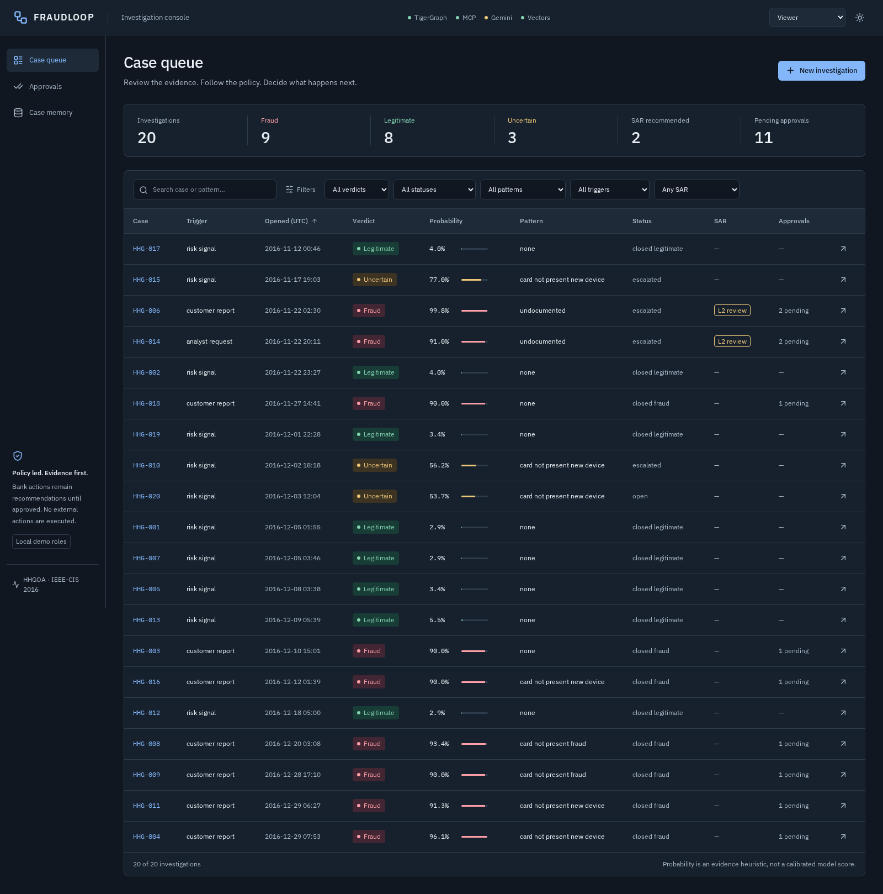
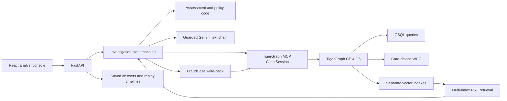
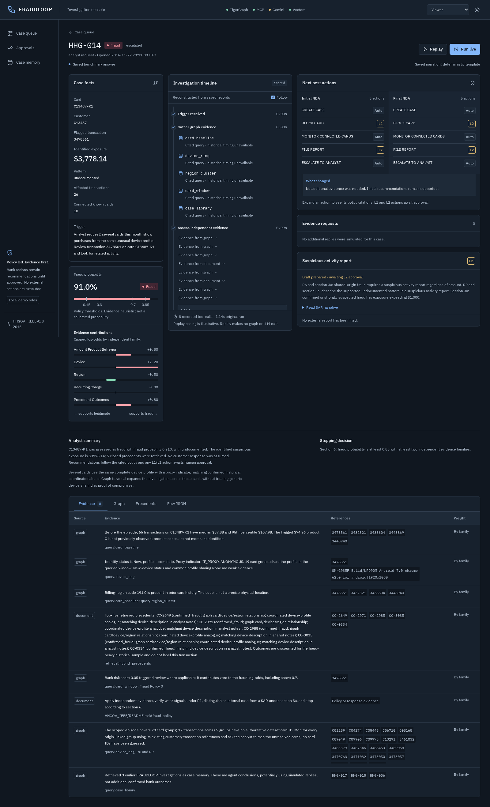
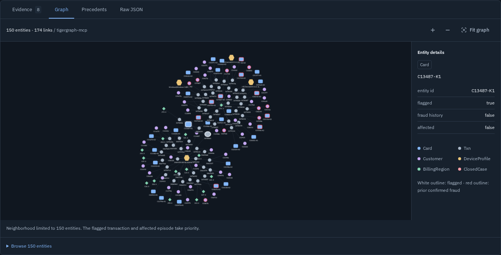
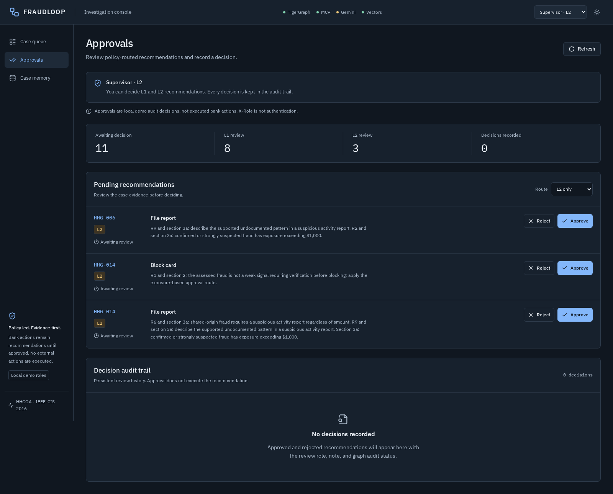

# FRAUDLOOP: making fraud decisions inspectable

## What we built

A fraud alert is a starting point. It does not tell an analyst whether a purchase was authorized, where an episode began, which other cards are involved, or whether a regulatory report is warranted. FRAUDLOOP turns that alert into an investigation with evidence, a bounded conclusion, and actions that follow an explicit policy.

I built FRAUDLOOP for the TigerGraph HHGOA Agentic Fraud Investigation hackathon. The benchmark provides anonymized transactions, identity records, historical investigations, and twenty new cases. Each answer must contain an internal case, a suspicious activity report when justified, and recommendations before and after any additional evidence. Those outputs are the submission's first priority.

The preserved answers contain nine fraud judgments, eight legitimate judgments, and three uncertain judgments, with two SAR recommendations. All twenty pass the project's schema, identifier, exposure, chronology, approval-route, and policy validation. These are the system's judgments, not an accuracy claim against the hidden answer key. Its probabilities are evidence heuristics, not a trained calibration model.

The analyst console makes those decisions inspectable. It offers a case queue, an investigation timeline, initial and final actions, graph neighborhoods, precedent provenance, approvals, and memory coverage. Replay provides a repeatable demonstration without consuming model quota or requiring a healthy graph service.

## Architecture

The React console talks to a FastAPI backend. The backend wraps an existing Python investigation state machine, exposes its events through Server-Sent Events, and serves saved answers and timelines. TigerGraph Community Edition 4.2.5 supplies graph evidence through the official TigerGraph MCP server and an MCP `ClientSession`.

Assessment and policy code own verdicts, probabilities, actions, routes, and stopping rules. Gemini receives bounded evidence and writes guarded prose. Local validation rejects invented citations or changed decisions. Quota failures move through a configured model chain; exhausted attempts return templates. The saved benchmark answers used templates, so they should not be presented as proof that live Gemini narration succeeded.

The console separates replay from live investigation. Replay streams saved events; live mode runs the agent and records new events. Health information distinguishes current graph checks from cached quota state and checkpoint coverage. A checkpoint is evidence of a previous successful upload, not a fresh inventory of the running graph.

## How TigerGraph is used

The graph connects customers, cards, transactions, device profiles, email domains, billing regions, historical closed cases, policy document chunks, and generated investigations. Directed edges and reverse edges support traversal from an alert to its history and neighboring entities. The prepared store contains 205,992 relevant transactions and all 5,565 supplied historical cases; the full raw transaction file is not loaded into memory during ordinary investigations.

Installed GSQL queries retrieve a card's recent window and baseline, expand a device neighborhood, inspect region activity, retrieve prior cases, search documents, and persist case answers. Every investigation uses its opening time as the evidence cutoff. A November investigation cannot borrow a December transaction or a later generated conclusion.

The graph also supports Card–Device weakly connected components. Earlier live verification found 4,954 components across 13,831 vertices. That is a historical infrastructure result, not a claim that every component represents a fraud ring. Connectivity directs attention; the investigation still needs evidence that a connection matters.

HHG-014 illustrates the distinction. Its scoped episode contains twenty card groups and twenty-six transactions totaling $3,778.14. A complete shared device profile, a proxy indicator, and historical coordinated-abuse precedents support the finding. Ten other authoritative card IDs are known; nine additional groups are referenced through existing customer and transaction IDs for analyst mapping. The agent does not invent card identifiers to make the graph look complete.

Historical narratives and policy chunks live alongside the graph evidence. Gemini 001, Gemini 2, EmbeddingGemma, and BGE have separate model-owned vector attributes; discovered preview models receive separate attributes too. Vectors have 768 dimensions and are normalized. A vector from one model is never compared with a query from another model's space.

Reciprocal Rank Fusion combines available index rankings with graph relationships and narrative matches. Missing embeddings do not erase a useful graph candidate. Provenance records which indexes and paths supported retrieval. Repeated retrieval of the same precedent improves its rank without multiplying its contribution to the fraud decision.

## Agentic capabilities

The investigation progresses through gathering, assessment, an initial recommendation, optional evidence requests, reassessment, a final recommendation, SAR drafting, and write-back. It can stop early when independent evidence supports an extreme probability, when verification settles authorization, or when further automated steps are unlikely to change the recommendation.

HHG-002 shows why recommendations must evolve. Its initial probability is 0.4335, supported by one evidence family. The agent recommends customer verification and monitoring. The explicitly simulated customer confirmation then lowers the probability to 0.04, clears the suspicious episode, and changes the final recommendation to closing the alert as legitimate. The timeline preserves both decisions and the reason for the change.

Evidence requests are selected using the unresolved question and retrieved precedents. Customer validation addresses authorization; step-up authentication tests the relevant account interaction; analyst information addresses unresolved exposure or conflict. The benchmark supplies no replies, so additional responses are deterministic simulations, clearly recorded as assumptions. Case-pack customer denials, by contrast, are supplied input.

Policy also separates an internal case from a SAR. Supported fraud needs an additional reporting trigger: sufficient exposure, a qualifying connection, or a coordinated or undocumented pattern. HHG-010 remains uncertain at $1,000.03; the amount alone does not force a report. HHG-014 warrants a report and an L2 card-block recommendation. A lower-exposure block routes to L1, while every report routes to L2.

Approvals record a human decision about recommendations; they do not execute card blocks or send regulatory filings. Graph write-back stores the investigation so later cases can retrieve it. Generated conclusions remain labeled as agent memory and are never promoted to confirmed historical bank outcomes.

## What we learned

The bank risk score can mislead above 0.7. The dataset documentation explicitly warns that most high-scoring transactions are legitimate. FRAUDLOOP therefore uses the score to trigger review and gives it zero direct weight in the fraud log odds. Amounts, timing, history, authorization, and relationships must explain the conclusion.

Coarse fingerprints create another trap. “Windows, Chrome, common screen resolution” may describe many unrelated people. Even a complete profile is not a unique hardware identifier. Partial profiles and new-device flags remain weak evidence unless other facts support a shared fraud origin. Billing-region codes likewise do not identify a precise physical location.

Correlated signals cannot be counted as independent discoveries. An unusual amount, unfamiliar product, and purchase burst may describe one behavioral change. Capped evidence families keep that cluster from overwhelming the decision. Historical outcomes also need correction because the supplied closed-case sample contains far more confirmed fraud than cleared alerts.

Free-tier embedding quotas made index ownership and resumability practical requirements. Generated vectors are cached before upload, checkpoints advance after persistence, and each model keeps its own space. Partial indexes remain useful through RRF. Separate credentials can separate clients, but independent quota still requires separate Google Cloud projects; merely having two keys proves nothing.

Memory pressure mattered as much as model selection. The host has 16 GB, and the Docker VM previously exposed only about 3.6 GiB. Long GSQL installations suffered service failures. We learned to verify installed queries rather than trust a successful CLI exit, avoid unnecessary compilation, and check GSE before writes. Replay gives the presentation a stable path when infrastructure is unavailable.

## What we'd improve

The next evaluation should measure calibration and false-positive costs on authorized held-out outcomes, rather than tune toward a desired verdict split. Better identity and merchant data would help distinguish genuine shared origins from common fingerprints and validate recurring-charge explanations without inventing merchant relationships.

Real customer and analyst integrations would replace simulated replies with attributable evidence. A production deployment would also bind approval roles to authenticated bank identity, strengthen durable event storage, and reconcile checkpoint coverage with live vector inventory. The current submission makes those boundaries visible: evidence can change a recommendation, uncertainty can remain unresolved, and a report is a policy decision that a human still approves.
