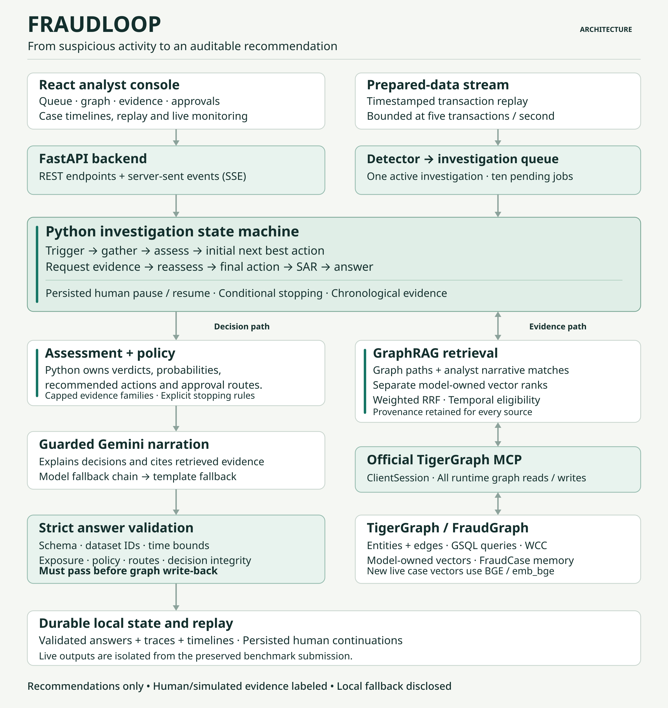
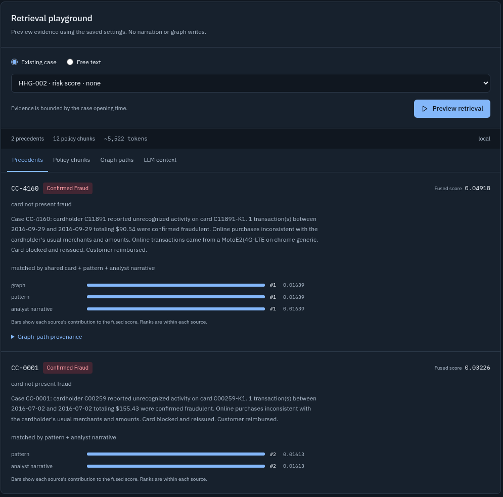
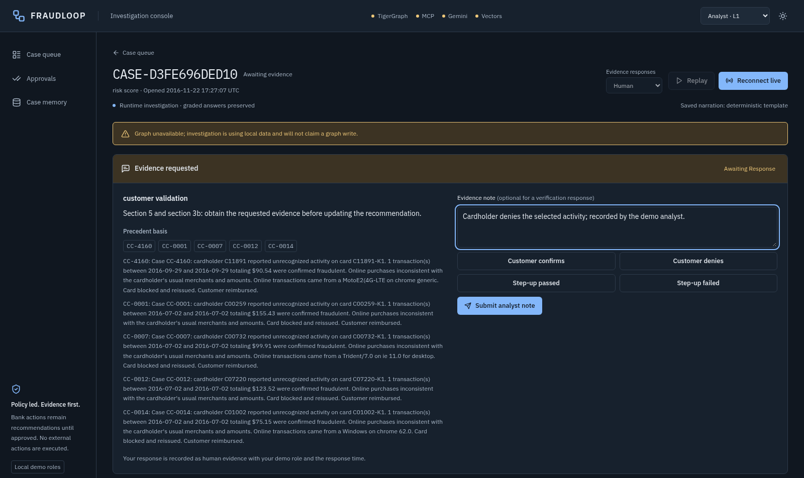

# FRAUDLOOP: Building a Fraud Investigation Agent with TigerGraph and Gemini

*Inside a working prototype that connects transaction graphs, historical cases, explicit policy, and human review to turn alerts into explainable recommendations.*

A $292.36 purchase receives a bank risk score of 0.79. It is well above the card's usual spending range. That makes it worth investigating, but several questions remain: did the customer authorize it, does it resemble earlier activity, and what should happen next?

This is the situation behind HHG-002, one of the supplied cases I used to build **FRAUDLOOP** for the TigerGraph HHGOA Agentic Fraud Investigation hackathon. The system initially recommends verification and monitoring. After an explicitly simulated customer confirmation, it changes its recommendation to closing the alert as legitimate. Both stages remain visible in the investigation record.

That ability to gather evidence, ask a relevant question, and explain a changed recommendation is the core of FRAUDLOOP. It combines a graph database, retrieval from historical investigations, deterministic policy rules, optional Gemini narration, and an analyst console.

The intended benefit is practical: give investigators one place to inspect the evidence, understand connected activity, review the applicable policy, and see what still requires human judgment.

## What an investigation produces

FRAUDLOOP accepts a risk alert, customer report, or analyst request. It investigates the activity as it was known at the case's opening time and produces a structured answer containing:

- A fraud, legitimate, or uncertain assessment, with supporting evidence and identified exposure.
- Relevant historical cases and the sources that made them relevant.
- Initial recommendations, requested evidence, and final recommendations.
- Required approval routes and an explanation of what changed.
- A suspicious activity report, or SAR, draft when the encoded policy requires one.
- A stopping reason and a record of whether graph write-back succeeded.

The distinction between an internal investigation and a SAR matters. A case can deserve investigation without meeting the policy requirements for regulatory reporting. FRAUDLOOP represents those decisions separately.

All bank actions are recommendations. An approval records a review decision; this prototype does not contact customers, block cards, or submit external reports.

## The architecture: from interface to evidence

The frontend is **React 18, TypeScript, and Vite**, with Tailwind for styling, TanStack Query for server state, and Cytoscape for graph visualization. A **FastAPI** backend serves cases, evidence requests, retrieval previews, approvals, and investigation events.

The investigation itself is a Python state machine. **TigerGraph Community Edition 4.2.5** stores relationships, historical cases, reference documents, and generated case memory. Runtime graph operations pass through the official TigerGraph Model Context Protocol server using an MCP `ClientSession`. Graph provisioning and query installation use a separate Docker/GSQL administration path.



*Conceptual control and data flow. Assessment and policy own the decisions; narration turns the resulting evidence brief into readable text. Graph access and validated write-back use MCP.*

Three responsibilities are explicit in the implementation. `agent/assess.py` evaluates evidence. `agent/policy.py` selects recommendations, approval routes, and stopping conditions. `agent/llm.py` writes constrained explanations after those decisions have been established.

FastAPI streams progress to the browser using **Server-Sent Events (SSE)**. The case investigation endpoint uses a POST stream, consumed through streaming `fetch`. Events such as `evidence_added`, `assessment`, `evidence_requested`, and `nba_final` populate the timeline as the investigation progresses. Here, NBA means “next best action.”

## Why a graph helps investigate fraud

A transaction becomes more informative when it can be compared with its surrounding activity. FRAUDLOOP's graph connects nine entity types: customers, cards, transactions, device profiles, email domains, billing regions, historical closed cases, document chunks, and generated investigations.

A simple relationship path illustrates the value:

```text
Card A → DeviceProfile ← Card B → Transaction
```

Starting from an alert on Card A, an investigator can examine another card associated with the same profile, inspect its transactions, and retrieve earlier investigations involving that activity. GSQL queries such as `card_window`, `card_baseline`, `device_ring`, and `region_cluster` supply these views.

The prepared working set contains **205,992 transactions and 5,565 historical closed cases**. Preparation uses a selected set of transaction columns and chunked processing rather than loading the full raw feature set for each investigation.

The graph also makes data limitations visible. A device profile combines software and device attributes; it is not a unique hardware identity. A common browser and screen resolution can connect unrelated people. Similarly, the dataset has no authoritative merchant identifier, so matching product codes cannot establish a recurring charge from the same merchant.

HHG-014 demonstrates a broader investigation. Its saved assessment scopes **26 transactions across 20 card groups**, totaling **$3,778.14**. Nine groups lack authoritative card IDs, so the answer cites existing customer and transaction references for analyst mapping. It does not invent identifiers to complete the picture. Supporting evidence leads to L2 recommendations for a card block and SAR filing.

Every investigation also has a time boundary: `opened_at`. Transactions after that boundary are excluded, historical outcomes must already be available, and generated case memory must come from earlier investigations. A case opened in November cannot borrow the answer to an investigation completed in December.

## GraphRAG: retrieving both relationships and meaning

Graph paths answer questions about connections. Historical narratives answer questions about similar behavior. FRAUDLOOP combines both through **GraphRAG**, or graph-assisted retrieval-augmented generation, and also makes retrieved precedents available to assessment.

The retrieval layer can use separate embedding indexes for Gemini Embedding 001, Gemini Embedding 2, EmbeddingGemma, and BGE. Each owns a distinct vector attribute: `embedding`, `emb_gem2`, `emb_gemma`, or `emb_bge`. Additional preview models receive separate attributes.

These indexes use normalized, 768-dimensional vectors. Equal dimensions do not make different models' embeddings interchangeable: a query must use the model that owns the index it searches.

FRAUDLOOP combines the available result lists with **weighted Reciprocal Rank Fusion (RRF)**:

```text
score(candidate) = sum(weight(source) / (k + rank(source, candidate)))
```

Only sources that returned the candidate contribute. With the default `k = 60` and unit weights, a candidate ranked first in one source and third in another receives `1/61 + 1/63`. This combines rankings without treating different embedding models' raw similarity scores as directly comparable.

Vector rankings join graph relationships, pattern matches, and analyst-narrative matches. A partial index can therefore contribute useful results while candidates without embeddings remain discoverable through other sources. Supported indexes are not necessarily fully populated or available in a given run.

Each result carries provenance: its source, rank, contribution to the fused score, and relevant graph paths. Retrieving the same precedent through several sources can improve its rank, but does not turn it into several independent pieces of fraud evidence.



*The retrieval inspector explains why a precedent appeared. This recorded local preview shows graph, pattern, and narrative contributions; it does not demonstrate a vector hit from every supported model.*

The GraphRAG page lets a supervisor adjust index selection, weights, retrieval counts, graph depth, lookback, and minimum vector similarity. It exposes the same serialized evidence context used for narration. Previewing performs retrieval without calling the narration model or writing graph data.

Each investigation freezes its retrieval configuration. If an analyst changes global settings while another case is waiting for evidence, that paused case keeps its original settings.

## Keeping decisions explicit

Assessment groups correlated observations into capped evidence families. For example, an unusual amount, unfamiliar product, and purchase burst can describe the same behavioral change; treating them as three independent discoveries would overstate the evidence.

The bank risk score contributes **zero direct weight** to assessment log-odds. It can help trigger review, but the investigation must establish its conclusion from the underlying evidence. Historical precedent outcomes are also discounted for the fraud-heavy composition of the supplied case sample.

The resulting probabilities are evidence heuristics, not estimates from a trained calibration model.

The benchmark's R1–R10 policy rules then determine what to recommend. Weak evidence can require verification before blocking. Customer confirmation can resolve an alert. Uncertainty with material exposure can require analyst escalation. Reporting needs a qualifying policy basis, rather than merely a large transaction amount.

Approval routing is implemented as ordinary, testable code. For example, a `BLOCK_CARD` recommendation routes to L1 when exposure is at most $2,500 and L2 above that amount. `BLOCK_ALL_CARDS` and `FILE_REPORT` require L2.

Gemini receives the bounded evidence brief and established decisions. Its structured draft is checked for allowed entity citations, decision consistency, required disclosures, and narrative constraints. Drafts that fail validation fall back to templates. The checks also reject detected claims that the system has already executed bank actions.

This separation allows narration to improve readability while keeping the decision path inspectable in code and evidence.

## The investigation loop and the human checkpoint

The state machine follows this sequence, skipping evidence requests and reassessment when an applicable stopping condition already holds:

```text
TRIGGER → GATHER → ASSESS → INITIAL_NBA
        → REQUEST_EVIDENCE → REASSESS → FINAL_NBA
        → SAR → WRITE_BACK → ANSWER
```

In human evidence mode, reaching `REQUEST_EVIDENCE` persists the assessment and continuation, then releases the graph session. An analyst can reload the page or restart the backend and still respond to the pending request.

Responses include customer confirmation or denial, step-up authentication results, and analyst notes. The record retains the source, selected demo role, and response time. Stale requests and conflicting duplicate submissions are rejected. Free-form notes remain attributed input and are excluded from the narration brief; they do not become verified facts simply because someone typed them.



*A recorded local investigation paused for analyst input. The interface identifies the demo role and discloses that no graph write will be claimed.*

The benchmark path also supports explicitly labeled deterministic simulations because its inputs do not provide interactive replies. In saved HHG-002, simulated confirmation changes the probability from approximately **0.433 to 0.040** and the verdict from uncertain to legitimate. Initial verification and monitoring give way to a recommendation to close the alert, while retaining the investigation record.

That example demonstrates how the policy responds to new evidence. It does not prove that a real customer authorized the purchase. Human-mode entries likewise record what an analyst entered, rather than authenticated communication with a bank customer.

## Making the workflow useful to an analyst

The console brings the queue, case facts, evidence contributions, timeline, graph neighborhood, precedents, SAR draft, and before-and-after actions into a single workflow. The “What changed” explanation connects an evidence response with its effect on the recommendation.

Approvals persist as audit records. Their identity incorporates the answer and final actions, so a changed recommendation requires a fresh review. The role selector demonstrates L1/L2 permissions through an `X-Role` header; production authentication would need a separate implementation.

Completed investigations can become retrievable case memory. They remain labeled as earlier agent conclusions and are excluded from confirmed historical-outcome scoring. This extends the evidence available to later investigations without silently treating generated conclusions as bank-confirmed truth.

The **Live monitor** demonstrates the path from incoming transaction to alert to investigation. It replays the final two calendar months of prepared historical data, with a ceiling of five transactions per second, one active investigation, and ten pending jobs. The detector considers risk bands, card velocity/testing, recent confirmed-fraud device history, and region novelty. Its score opens a review; assessment and policy determine the case outcome.

Two supporting tools extend the workflow. The Data page previews authoritative transaction reingestion and reference-document uploads before supervisor commit. Uploaded reference prose cannot rewrite the encoded policy. Pattern discovery proposes connected groups for investigation, distinguishing native whole-graph WCC counts from windowed memberships computed from prepared relationships. The recorded 30-day scan found no qualifying new group, and the interface reports that empty result.

Together, these features are intended to reduce evidence gathering and handoff friction. The project has not yet measured analyst time saved, fraud losses prevented, or false-positive reduction.

## Reliability under practical constraints

Embedding ingestion caches vectors before graph upload and advances checkpoints only after successful persistence. Separate model checkpoints and an index lock protect ownership and resumability. A checkpoint describes a previous successful upload; it is not proof of current coverage after a graph rebuild.

Generation and embedding use separate SDK clients and can use separate credentials. Persistent quota cooldowns and a configurable model chain allow narration to fall through to another model or to templates. Model discovery establishes advertised capabilities, not remaining quota or guaranteed availability.

The backend checks graph write readiness and exposes local fallback when graph operations remain unavailable. A locally completed investigation reports `written_to_graph=false`. New live results use `cases_live/` and `data/timelines_live/`, preserving the graded answers. Successful answer, trace, and timeline snapshots are saved atomically, while failed attempts are recorded separately.

Replay provides a repeatable demonstration without graph or model calls. Timelines reconstructed from older saved traces are labeled accordingly; missing historical timings are not presented as fresh measurements.

## What has been verified

The preserved twenty answers contain **nine fraud, eight legitimate, and three uncertain judgments, with two SAR recommendations**. I revalidated them while preparing this article: all passed the project's schema, dataset-ID, exposure, chronology, approval-route, and policy checks.

Those results describe the system's outputs and their consistency with its checks. They are not an accuracy score against a hidden answer key.

The recorded September 25, 2026 upgrade verification reports **286 passing Python tests**, a successful frontend build and TypeScript checks, and browser coverage of human evidence, GraphRAG, stream-to-case flow, role restrictions, and responsive layouts. Native MCP checks verified selected transaction/edge operations and WCC execution.

The saved benchmark answers used template narration and predate the multi-index refactor. They should not be used as evidence of the newer retrieval behavior or live Gemini quality. The upgrade's browser workflows also used templates; native reference-document ingestion and current Gemini availability were not established by those checks.

Further evaluation should measure calibration, false-positive costs, retrieval quality, and analyst completion time on authorized held-out outcomes. Production work would also require authenticated identities, customer and bank integrations, and more durable stream scheduling. The current stream cursor and automatic scheduling are process-local, while cases, evidence requests, and queued trigger records persist.

## Trying the investigation flow

In a configured checkout with dependencies and prepared data already present, the predictable local demo starts with:

```bash
FRAUDLOOP_LOCAL_ONLY=1 FRAUDLOOP_ENABLE_LLM=0 make demo
```

Open `http://localhost:5173`. Replay HHG-002 to follow a changed recommendation, then inspect HHG-014 for expanded exposure and L2 routing. Use GraphRAG to inspect why a precedent was retrieved, or create a human-mode investigation to see the workflow pause and resume with an attributed response.

FRAUDLOOP gives an investigator a traceable path from an alert to evidence, from evidence to a policy decision, and from that decision to a recommendation ready for review. Building that path made the relationships between retrieval, uncertainty, and human judgment as important as the model itself.
